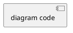
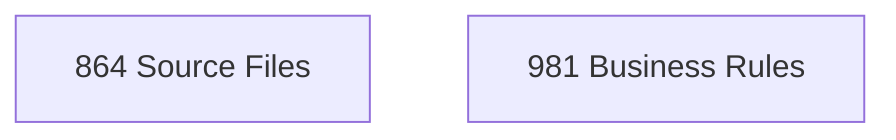

# /reforge.generate

> Generate documentation and artifacts from extracted metadata

## Command Syntax

```
/reforge.generate <format> [--output <path>] [--scope <type>]
```

### Arguments

| Argument | Required | Description |
|----------|----------|-------------|
| `format` | Yes | Output format: `markdown`, `user-stories`, `data-dictionary`, `uml`, `sysml`, `cross-mappings`, `features`, `registries` |
| `--output` | No | Custom output path (defaults to `$GENERATED_DIR/`) |
| `--scope` | No | Limit to specific extraction type: `business-rules`, `database`, `ui`, `workflows` |

## Overview

This command generates documentation and artifacts from the XML extractions:

- **markdown**: Comprehensive documentation of all extractions
- **user-stories**: Modernization backlog items with acceptance criteria
- **data-dictionary**: Database entity and column documentation
- **uml**: UML class diagrams in PlantUML/Mermaid notation
- **sysml**: SysML block diagrams for system architecture
- **cross-mappings**: Traceability matrix mapping features → requirements → rules → workflows → UI → source
- **features**: Feature catalog with functional/non-functional requirements derived from extractions
- **registries**: Human-readable summary tables of extracted rules and requirements

## Prerequisites

- At least one extraction must be completed
- Relevant XML files must exist in `$EXTRACTIONS_DIR/`

---

## Step 0: Check Prerequisites

Run the prerequisites script to validate state and resolve paths:

```bash
# For markdown, user-stories, sysml:
reforge-scripts check-prerequisites --json --require-analysis

# For data-dictionary and uml (which require database extraction):
reforge-scripts check-prerequisites --json --require-analysis --require-extraction database
```

This returns JSON with resolved variables:
```json
{"PROJECT_NAME":"...","REPO_ROOT":"...","PROJECT_OUTPUT_DIR":"...","CONFIG":"...","ANALYSIS_STATUS":"completed","AVAILABLE_EXTRACTIONS":[...],"CHECKPOINT":null,"CLARIFICATIONS_DIR":"..."}
```

Use `$PROJECT_OUTPUT_DIR` for all output paths in subsequent steps.

Assign subdirectory variables:
```
$EXTRACTIONS_DIR = $PROJECT_OUTPUT_DIR/extractions
$GENERATED_DIR = $PROJECT_OUTPUT_DIR/generated
$DIAGRAMS_DIR = $PROJECT_OUTPUT_DIR/diagrams
$DERIVED_DIR = $PROJECT_OUTPUT_DIR/derived
$ANALYSIS_DIR = $PROJECT_OUTPUT_DIR/analysis
```

### Step 0.5: Load Project Context

If `.reforge/memory/project-context.md` exists, read it now. Use its contents as
supplemental guidance throughout this command's execution:
- **Technology Stack**: Informs language/framework detection and pattern recognition
- **Domain Knowledge**: Provides business context for naming and categorization
- **Analysis Guidelines**: Directs focus and exclusions beyond config.json
- **Custom Rules**: Additional rules to follow alongside the constitution

### Step 0.6: Source-Anchored Generation Constraints

Before any generation begins, the agent MUST internalize and apply these 7 mandatory constraints.
These constraints govern ALL output produced by this command — no generation step may proceed
until these constraints are acknowledged.

**Constraint 1 — Extraction XML as Sole Source of Truth**: The agent MUST use extraction XML
files (`$EXTRACTIONS_DIR/**/*.xml`) and analysis XML (`$ANALYSIS_DIR/analysis.xml`) as the
sole source of factual content. Every identifier, statistic, description, and relationship in
generated output MUST trace to a specific element in an extraction XML file. No content may
originate from the agent's training data, general knowledge, or assumptions about the target
system.

**Constraint 2 — No Embellishment or Paraphrasing**: The agent MUST NOT embellish, paraphrase,
or add interpretive commentary beyond what is explicitly stated in extraction XML. If an
extraction describes a business rule as "Apply 10% discount for orders over $100", the generated
output MUST reflect this exact meaning — not rephrase it as "A generous discount program rewards
high-value customers." Adjectives, qualifiers, and characterizations not present in the
extraction data are prohibited.

**Constraint 3 — No LLM Training-Data Contamination**: The agent MUST NOT inject knowledge
from its training data about the target system, its domain, or similar systems. If the extraction
data does not mention a specific technology, pattern, or behavior, the agent MUST NOT assume or
assert its existence. The agent MUST NOT infer internal mechanisms, design patterns, or
architectural decisions beyond what the extraction data explicitly documents. The agent generates
from extraction data, not from what it "knows" about the domain.

**Constraint 4 — Verbatim Identifier Copying**: The agent MUST copy all identifiers (class names,
method names, table names, column names, variable names, enum values, status codes, file paths)
character-for-character from extraction XML. No case changes, no abbreviations, no expansions,
no corrections of apparent typos. If the extraction XML contains `PTC_Status`, the output MUST
say `PTC_Status` — not `PTCStatus`, `ptc_status`, or `PtcStatus`.

**Constraint 5 — Computed Totals with Derivation Formulas**: The agent MUST compute all numeric
totals by counting elements in extraction XML at generation time. The agent MUST NOT estimate,
approximate, or recall counts from prior runs. Every stated total MUST include its derivation
formula showing the computation. For example: "Total functional requirements: 938
(541 + 87 + 85 + 98 + 127)" where each addend corresponds to a per-file element count.
When extraction XML uses non-standard element names (e.g., `<req>` instead of `<requirement>`,
or `<br>` instead of `<business-rule>`), the agent MUST adapt its counting methodology to the
actual element names present in the XML — but MUST still count every element, never estimate.

**Constraint 6 — Source Code Boundary**: The agent MUST NOT read, reference, or quote source
code files directly during generation. All source information MUST come from extraction XML,
which already contains relevant source references (file paths, line numbers, code snippets).
If a generated section requires source code context not present in extraction data, the agent
MUST emit a `[DATA GAP]` marker rather than reading the source file.

**Constraint 7 — When in Doubt, Omit with `[DATA GAP]`**: When extraction data is insufficient
to populate a generated section with verified content, the agent MUST emit a
`[DATA GAP: <description> -- run /reforge.extract <type> to fill]` marker. The agent MUST NOT
fabricate content to fill gaps. Omission with explicit marking is always preferable to
fabrication. Each `[DATA GAP]` marker MUST include a brief description of what data is missing
and recommend the appropriate `/reforge.extract` command to obtain it.

These constraints apply to all generation formats (markdown, user-stories, data-dictionary,
uml, sysml, cross-mappings, features, registries) and to both full and selective regeneration
runs.

### Step 0.7: Check/Update Project Plan

If `.reforge/memory/project-plan.md` exists, read it now.

**On command start:**
- Parse the plan file to count total items and completed items
- Display: "📋 Project Plan: X/Y items complete (Z%)"
- If `--scope` was specified, identify the item tagged `<!-- reforge:generate:<scope> -->` and display its status
- If no `--scope` was specified, display all generate-related items and their status

**On command completion (success only):**
- If `--scope` was specified:
  - Locate the plan item by searching for `<!-- reforge:generate:<scope> -->`
  - If found and unchecked (`- [ ]`): change to `- [x]` and append ` *(completed: YYYY-MM-DD)*`
  - If found and already checked (`- [x]`): leave unchanged (idempotent)
  - If tag not found: emit warning — "⚠️ No plan item found for this generation scope. Run /reforge.plan to add it."
- If no `--scope` was specified:
  - Determine which extraction types contributed to the generated output
  - For each contributing type, search for `<!-- reforge:generate:<type> -->` and mark it complete
  - Report how many plan items were updated
- If file write fails: emit warning — "⚠️ Could not update project plan." Continue without failing.
- Update the `**Last Updated**` metadata line to today's date

If `.reforge/memory/project-plan.md` does not exist, skip this step silently.
The project plan is optional — its absence MUST NOT affect command behavior.

### Step 0.8: Load Glossary (Optional)

If `.reforge/memory/glossary.json` exists, read it now and store the `terms` map for use during content generation.

**Acronym Expansion Rules** (when glossary is loaded):
- On first occurrence of a glossary term in each document section: expand as "TERM (Full Expansion)"
- On subsequent occurrences within the same section: use "TERM" only
- Reset the "first occurrence" tracker at each new top-level section boundary (e.g., `## Section`)
- Only expand terms present in the glossary with confidence >= 0.5
- Do not expand terms inside code blocks, file paths, or XML/JSON examples

**Glossary Appendix**: When generating documents that include appendices, add a "Glossary" appendix listing all glossary terms used in the document with their expansions, sorted alphabetically. Each entry should include the term, its full expansion, and a brief definition if available from the glossary data. If no glossary terms were used in the document, omit the glossary appendix.

If `.reforge/memory/glossary.json` does not exist, skip this step silently.
The glossary is optional — its absence MUST NOT affect command behavior.

---

# Markdown Generation

## Command

```
/reforge.generate markdown
```

## Output

`$GENERATED_DIR/documentation.md`

## Template

```markdown
# [Project Name] - Legacy Codebase Documentation

> Generated by Reforge on [timestamp]
> Source: [root-path]

### Template Placeholder Specification

Template variables MUST map to extraction XML sources with typed derivations. The agent MUST
resolve each placeholder by counting or reading extraction XML elements — never by recalling
values from training data or prior runs.

| Placeholder | Type | Source XPath | Derivation Requirement |
|-------------|------|-------------|------------------------|
| `{{total_files}}` | count | `//file` in `$ANALYSIS_DIR/analysis.xml` | State count value |
| `{{total_modules}}` | count | `//module` in `$ANALYSIS_DIR/analysis.xml` | State count value |
| `{{total_business_rules}}` | count | `//rule` across `$EXTRACTIONS_DIR/business-rules/*.xml` | Show per-file sum formula |
| `{{total_requirements}}` | count | Element counts across `$EXTRACTIONS_DIR/functional-requirements/*.xml` | Show per-file sum formula (e.g., "541 + 87 + 85 + 98 + 127 = 938") |
| `{{total_nfr}}` | count | Element counts across `$EXTRACTIONS_DIR/non-functional/*.xml` | Show per-file sum formula |
| `{{total_ui_components}}` | count | Element counts across `$EXTRACTIONS_DIR/ui/*.xml` | Show per-file sum formula |
| `{{entity.name}}` | identifier | Verbatim from extraction XML element text | Copy character-for-character |
| `{{rule.description}}` | description | Verbatim from extraction XML element text | No paraphrasing allowed |

For **count** type placeholders, the generated output MUST include the derivation formula
alongside the value. For **identifier** type placeholders, the value MUST be copied verbatim.
For **description** type placeholders, the text MUST reflect the exact meaning from extraction
XML without embellishment.

## Table of Contents

1. [Overview](#overview)
2. [Business Rules](#business-rules)
3. [Data Model](#data-model)
4. [User Interface](#user-interface)
5. [Workflows](#workflows)
6. [Traceability Matrix](#traceability-matrix)

---

## Overview

### Analysis Summary

| Metric | Value |
|--------|-------|
| Total Files | [count] |
| Languages | [list] |
| Frameworks | [list] |
| Analysis Date | [date] |

### Extraction Summary

| Type | Items | High Conf | Med Conf | Low Conf |
|------|-------|-----------|----------|----------|
| Business Rules | [N] | [N] | [N] | [N] |
| Database Entities | [N] | [N] | [N] | [N] |
| UI Components | [N] | [N] | [N] | [N] |
| Workflows | [N] | [N] | [N] | [N] |

---

## Business Rules

### By Category

#### Validation Rules

| ID | Description | Confidence | Source |
|----|-------------|------------|--------|
| [id] | [description] | [conf] | [file:line] |

#### Pricing Rules
...

#### Authorization Rules
...

### Rule Details

#### [BR-001]: [Title]

**Category**: [category]
**Confidence**: [level]

**Logic**:
```
[pseudo-code logic]
```

**Source**: `[file]:[line-start]-[line-end]`

```[language]
[code snippet]
```

**Related Entities**: [list]
**Related Rules**: [list]

---

## Data Model

### Entity Relationship Diagram

```mermaid
[ERD diagram]
```

### Entities

#### [Entity Name]

| Column | Type | Nullable | PK | FK |
|--------|------|----------|----|----|
| [name] | [type] | [Y/N] | [✓] | [ref] |

**Source**: `[file]:[lines]`

### Relationships

| From | To | Type |
|------|-----|------|
| [entity.column] | [entity.column] | [type] |

### SQL Interactions

#### By Operation Type

| Operation | Count |
|-----------|-------|
| SELECT | [N] |
| INSERT | [N] |
| UPDATE | [N] |
| DELETE | [N] |

---

## User Interface

### Screen Inventory

| ID | Name | Path | Components |
|----|------|------|------------|
| [id] | [name] | [path] | [count] |

### Screen Details

#### [Screen Name]

**Path**: [url-path]
**Source**: `[file]`

**Layout**:
```
[ASCII layout]
```

**Components**:

| ID | Type | Label | Events |
|----|------|-------|--------|
| [id] | [type] | [label] | [events] |

### Navigation Flows

```mermaid
graph LR
  [flow diagram]
```

---

## Workflows

### Workflow Inventory

| ID | Name | Trigger | Steps | Confidence |
|----|------|---------|-------|------------|
| [id] | [name] | [trigger] | [count] | [level] |

### Workflow Details

#### [WF-001]: [Workflow Name]

**Trigger**: [trigger-type]
**Entry Point**: `[class.method]`
**Confidence**: [level]

**Description**: [description]

**Flow**:
```
1. [step description]
   └─ [method/class]
2. [decision point]
   ├─ [condition A] → [action]
   └─ [condition B] → [action]
3. [step description]
```

**Related Elements**:
- Business Rules: [list]
- Database Operations: [list]
- UI Components: [list]

---

## Traceability Matrix

### Business Rules → Source Files

| Rule | Files |
|------|-------|
| [BR-001] | [file1], [file2] |

### Workflows → Components

| Workflow | Rules | DB Ops | UI |
|----------|-------|--------|-----|
| [WF-001] | [BR-001, BR-002] | [DB-001] | [CMP-001] |

---

## Appendices

### A. File Inventory

[Condensed file listing by language/type]

### B. Glossary

If glossary data was loaded in Step 0.8, generate a glossary appendix listing every glossary
term that was referenced in this document. For each term, include:

| Term | Expansion | Definition |
|------|-----------|------------|
| [TERM] | [Full Expansion] | [Brief definition from glossary data, if available] |

Sort entries alphabetically by term. Only include terms that actually appeared in the document
body. If no glossary was loaded or no glossary terms were used, emit:

[No glossary data available — run /reforge.glossary to generate]

### C. Low Confidence Items

[Items requiring clarification]

---

*Generated by Reforge v1.0.0*
```

---

# User Stories Generation

## Command

```
/reforge.generate user-stories
```

## Output Files

- `$GENERATED_DIR/user-stories.md` (Markdown)
- `$GENERATED_DIR/user-stories.json` (JSON)
- `$GENERATED_DIR/user-stories.csv` (CSV)
- `$GENERATED_DIR/user-stories.xml` (Schema-compliant XML)

## Generation Process

### Step 1: Load Extractions

Read:
- `$EXTRACTIONS_DIR/business-rules.xml` → Source for acceptance criteria
- `$EXTRACTIONS_DIR/workflows.xml` → Source for user journeys
- `$EXTRACTIONS_DIR/ui-flows.xml` → Source for interaction stories
- `$EXTRACTIONS_DIR/database.xml` → Source for data-related stories

### Step 2: Generate Epics

Group related functionality into epics:

1. **From workflows**: Each major workflow becomes an epic
2. **From UI screens**: Related screens become epics
3. **From domain entities**: CRUD operations per entity

### Step 3: Generate Stories

For each epic, create stories:

#### From Business Rules

```
Rule: "Apply 10% discount for orders over $100"

→ Story: "Apply Order Discount"
  As a: Customer
  I want: to receive applicable discounts on my order
  So that: I pay a fair price based on my order value

  Acceptance Criteria:
  - Given I have items totaling over $100
    When I submit my order
    Then a 10% discount is applied

  Traceability: BR-001
```

#### From Workflows

```
Workflow: "Order Submission"

→ Epic: "Order Management"
  Stories:
  - Create new order
  - Submit order for processing
  - View order status
  - Cancel pending order

  Each with steps from workflow as acceptance criteria
```

#### From UI Components

```
Screen: "Order List"
Button: "New Order"

→ Story: "Create New Order"
  As a: User
  I want: to create a new order from the order list
  So that: I can start the ordering process

  Traceability: SCR-001, CMP-001
```

### Step 4: Assign Priority

| Source Signal | Priority |
|---------------|----------|
| High-confidence business rule | High |
| Core workflow entry point | High |
| Primary UI screen | High |
| Medium-confidence rule | Medium |
| Secondary workflow | Medium |
| Supporting UI component | Low |

### Step 5: Estimate Story Points

| Complexity | Points |
|------------|--------|
| Single rule, no branches | 1-2 |
| Rule with conditions + workflow | 3-5 |
| Multiple workflows + UI + database | 5-8 |
| Complex branching + external calls | 8-13 |

### Step 6: Generate Outputs

#### Markdown Output

Use template from `.reforge/templates/user-story.md`:

```markdown
# Modernization User Stories

> Generated from [project] analysis on [date]

## Epic: [Epic Title]

### US-001: [Story Title]

**Priority**: High | **Points**: 5

**As a** [role],
**I want** [action],
**So that** [benefit].

#### Acceptance Criteria

- [ ] **AC-001**: Given [context], when [action], then [outcome].
- [ ] **AC-002**: Given [context], when [action], then [outcome].

#### Traceability

| Type | ID | Confidence |
|------|-----|------------|
| Business Rule | BR-001 | High |
| Workflow | WF-001 | High |
| UI Component | CMP-001 | High |

---
```

#### JSON Output

```json
{
  "project": "[project-name]",
  "generated": "[timestamp]",
  "epics": [
    {
      "id": "EPIC-001",
      "title": "[title]",
      "stories": ["US-001", "US-002"]
    }
  ],
  "stories": [
    {
      "id": "US-001",
      "title": "[title]",
      "epic_ref": "EPIC-001",
      "priority": "high",
      "points": 5,
      "as_a": "[role]",
      "i_want": "[action]",
      "so_that": "[benefit]",
      "acceptance_criteria": [
        {
          "id": "AC-001",
          "given": "[context]",
          "when": "[action]",
          "then": "[outcome]",
          "source_ref": "BR-001"
        }
      ],
      "traceability": {
        "business_rules": ["BR-001"],
        "workflows": ["WF-001"],
        "ui_components": ["CMP-001"],
        "database_ops": []
      }
    }
  ]
}
```

#### CSV Output

```csv
ID,Title,Epic,Priority,Points,As A,I Want,So That,Criteria Count,Rules,Workflows
US-001,"[title]",EPIC-001,high,5,"[role]","[action]","[benefit]",2,"BR-001","WF-001"
```

### Step 7: Report Results

```
User Stories Generation Complete!

Output files:
- $GENERATED_DIR/user-stories.md
- $GENERATED_DIR/user-stories.json
- $GENERATED_DIR/user-stories.csv
- $GENERATED_DIR/user-stories.xml

Summary:
- Epics: 8
- Stories: 45
- Total story points: 187

Priority breakdown:
- Critical: 5 stories (28 points)
- High: 15 stories (67 points)
- Medium: 18 stories (72 points)
- Low: 7 stories (20 points)

Stories ready for import into project management tools.
```

---

# Data Dictionary Generation

## Command

```
/reforge.generate data-dictionary
```

## Output

`$GENERATED_DIR/data-dictionary.md`

## Template

Use `.reforge/templates/data-dictionary.md`:

```markdown
# Data Dictionary: [Project Name]

> Generated: [timestamp]

## Overview

| Metric | Value |
|--------|-------|
| Total Entities | [N] |
| Total Relationships | [N] |
| Discovery Sources | [DDL, ORM, Inferred] |

---

## Entities

### [Entity Name]

| Property | Value |
|----------|-------|
| ID | `[E-XXX]` |
| Type | [table/view/entity/dto] |
| Source | [ddl/orm/inferred] |
| Confidence | [high/medium/low] |
| Location | `[file:lines]` |

#### Columns

| Column | Type | Nullable | PK | FK | Description |
|--------|------|----------|----|----|-------------|
| `[name]` | [type] | [Y/N] | [✓] | `[ref]` | [desc] |

#### Referenced By

| Entity | Column | Relationship |
|--------|--------|--------------|
| [entity] | [column] | [type] |

---

## Relationships

| From | → | To | Type |
|------|---|-----|------|
| `[entity.column]` | → | `[entity.column]` | [type] |

---

## Entity Relationship Diagram

### PlantUML



### Mermaid

```mermaid
erDiagram
[diagram code]
```
```

---

# UML Diagram Generation

## Command

```
/reforge.generate uml
```

## Output

`$DIAGRAMS_DIR/sources/class-diagram.puml`
`$DIAGRAMS_DIR/sources/class-diagram.mmd`

## Template

Use `.reforge/templates/uml-class.md`:

### PlantUML Output

```plantuml
@startuml [project]-class-diagram
!theme plain
skinparam linetype ortho

title [Project Name] - Class Diagram

' Entities from database extraction
class [EntityName] {
  +[pk_column] : [type]
  -[column] : [type]
  -[fk_column] : [type]
}

' Relationships
[Entity1] "1" -- "*" [Entity2] : [relationship]

@enduml
```

### Mermaid Output

```mermaid
classDiagram
    direction TB

    class [EntityName] {
        +[type] [pk_column]
        -[type] [column]
    }

    [Entity1] "1" -- "*" [Entity2] : [relationship]
```

---

# SysML Diagram Generation

## Command

```
/reforge.generate sysml
```

## Output

`$DIAGRAMS_DIR/sources/block-diagram.puml`

## Template

Use `.reforge/templates/sysml-block.md`:

```plantuml
@startuml [project]-bdd
!theme plain

title [Project Name] - Block Definition Diagram

' Blocks from workflow analysis
package "[System Name]" <<block>> {

  block "[Module Name]" as M1 <<block>> {
    ' Parts from entities
    part [entity] : [EntityType]
    --
    ' Operations from workflows
    op [methodName]([params]) : [return]
  }

}

' Relationships
M1 --> M2 : [relationship]

@enduml
```

---

# Cross-Mappings Generation

## Command

```
/reforge.generate cross-mappings
```

## Output

`$DERIVED_DIR/cross-mappings.xml`

## Generation Process

### Step 1: Load All Sources

Read:
- `$ANALYSIS_DIR/analysis.xml` → Source file inventory
- `$EXTRACTIONS_DIR/business-rules.xml` → Business rules
- `$EXTRACTIONS_DIR/database.xml` → Database interactions
- `$EXTRACTIONS_DIR/ui-flows.xml` → UI components
- `$EXTRACTIONS_DIR/workflows.xml` → Workflow definitions

### Step 2: Identify Features

Group related extractions into logical features:
- Workflows with shared entities → feature group
- UI screens with related business rules → feature group
- Database entities with CRUD workflows → feature group

### Step 3: Build Traceability Matrix

For each identified feature, trace connections:
1. **Functional requirements** derived from business rules
2. **Business rules** applied in the feature
3. **Workflows** that implement the feature
4. **UI components** that trigger or display the feature
5. **Source files** that contain the implementation

### Step 4: Generate Output

Write to `$DERIVED_DIR/cross-mappings.xml` following the schema in `.reforge/schemas/cross-mappings.md`.

### Step 5: Report Results

```
Cross-Mappings Generation Complete!

Output: $DERIVED_DIR/cross-mappings.xml

Summary:
- Features traced: [N]
- Requirements mapped: [N]
- Rules linked: [N]
- Workflows connected: [N]
- Source files referenced: [N]
```

---

# Features & Requirements Generation

## Command

```
/reforge.generate features
```

## Output

`$DERIVED_DIR/features-requirements.xml`

## Generation Process

### Step 1: Load All Sources

Read:
- `$ANALYSIS_DIR/analysis.xml` → Project structure
- `$EXTRACTIONS_DIR/business-rules.xml` → Business rules
- `$EXTRACTIONS_DIR/database.xml` → Data model
- `$EXTRACTIONS_DIR/ui-flows.xml` → UI components
- `$EXTRACTIONS_DIR/workflows.xml` → Workflow definitions

### Step 2: Derive Features

Identify features from extraction patterns:
- Major workflows → features
- Groups of related business rules → features
- UI screen clusters → features
- Domain entity operations → features

For each feature, assign:
- ID (FT-001, FT-002, ...)
- Name (descriptive title)
- Priority (critical, high, medium, low)
- Description
- Source components and related rules/workflows

### Step 3: Derive Functional Requirements

For each feature, derive functional requirements:
- Business rules → specific acceptance criteria
- Workflow steps → process requirements
- UI interactions → user-facing requirements

For each requirement:
- ID (FR-001, FR-002, ...)
- Feature reference
- Priority
- Description
- Acceptance criteria
- Source evidence (extraction references)

### Step 4: Derive Non-Functional Requirements

Analyze extractions for non-functional patterns:
- Performance constraints (response times, throughput)
- Security requirements (auth, encryption)
- Scalability needs (data volumes, concurrent users)
- Reliability requirements (error handling, recovery)

For each requirement:
- ID (NFR-001, NFR-002, ...)
- Category (performance, security, scalability, reliability)
- Priority
- Description, metric, and threshold
- Source evidence

### Step 5: Generate Output

Write to `$DERIVED_DIR/features-requirements.xml` following the schema in `.reforge/schemas/features-requirements.md`.

### Step 6: Report Results

```
Features & Requirements Generation Complete!

Output: $DERIVED_DIR/features-requirements.xml

Summary:
- Features: [N]
- Functional Requirements: [N]
- Non-Functional Requirements: [N]
- Priority breakdown:
  - Critical: [N]
  - High: [N]
  - Medium: [N]
  - Low: [N]
```

---

# Registries Generation

## Command

```
/reforge.generate registries
```

## Output

- `$DERIVED_DIR/registries/business-rules-registry.md`
- `$DERIVED_DIR/registries/functional-requirements-registry.md`
- `$DERIVED_DIR/registries/non-functional-requirements-registry.md`

## Generation Process

### Step 1: Load Sources

Read:
- `$EXTRACTIONS_DIR/business-rules.xml` → For business rules registry
- `$DERIVED_DIR/features-requirements.xml` → For requirements registries (must run `/reforge.generate features` first)

### Step 2: Generate Business Rules Registry

Create a human-readable summary table:

```markdown
# Business Rules Registry

> Generated: [timestamp]

| ID | Category | Description | Confidence | Source |
|----|----------|-------------|------------|--------|
| BR-001 | pricing | Apply 10% discount for orders over $100 | high | src/service/PricingService.java:45 |
| BR-002 | validation | Order must have at least one item | high | src/model/Order.java:78 |
...
```

### Step 3: Generate Functional Requirements Registry

```markdown
# Functional Requirements Registry

> Generated: [timestamp]

| ID | Feature | Priority | Description | Acceptance Criteria | Source |
|----|---------|----------|-------------|---------------------|--------|
| FR-001 | FT-001 | high | [description] | [criteria count] | BR-001, WF-001 |
...
```

### Step 4: Generate Non-Functional Requirements Registry

```markdown
# Non-Functional Requirements Registry

> Generated: [timestamp]

| ID | Category | Priority | Description | Metric | Threshold | Source |
|----|----------|----------|-------------|--------|-----------|--------|
| NFR-001 | performance | high | [description] | Response time | <200ms | WF-001 |
...
```

### Step 5: Report Results

```
Registries Generation Complete!

Output files:
- $DERIVED_DIR/registries/business-rules-registry.md
- $DERIVED_DIR/registries/functional-requirements-registry.md
- $DERIVED_DIR/registries/non-functional-requirements-registry.md

Summary:
- Business rules: [N] entries
- Functional requirements: [N] entries
- Non-functional requirements: [N] entries
```

---

## Canonical Metrics Computation

Before generating any output, the agent MUST compute a canonical metrics table by counting
elements in extraction XML files. This table serves as the single authoritative source for
all statistics referenced throughout the generated output.

The agent MUST construct the following metrics table at the start of each generation run:

| Metric | Source | Value | Formula |
|--------|--------|-------|---------|
| total_files | `$ANALYSIS_DIR/analysis.xml //file` | [N] | `count(//file)` |
| total_modules | `$ANALYSIS_DIR/analysis.xml //module` | [N] | `count(//module)` |
| total_business_rules | `$EXTRACTIONS_DIR/business-rules/*.xml //rule` | [N] | Sum of per-file `count(//rule)` |
| total_functional_reqs | `$EXTRACTIONS_DIR/functional-requirements/*.xml` | [N] | Sum of per-file element counts |
| total_nfr | `$EXTRACTIONS_DIR/non-functional/*.xml` | [N] | Sum of per-file element counts |
| total_ui_components | `$EXTRACTIONS_DIR/ui/*.xml` | [N] | Sum of per-file element counts |

**Rules**:

1. The agent MUST recompute this table fresh for every generation run — never reuse metrics from a prior run
2. Each metric's `Formula` column MUST show the actual per-file breakdown (e.g., "541 + 87 + 85 + 98 + 127 = 938")
3. When extraction XML uses non-standard element names, the agent MUST adapt the XPath to the actual element names present
4. The computed metrics table MUST be persisted as `$PROJECT_OUTPUT_DIR/metrics-registry.xml` following the metrics-registry schema (`.reforge/schemas/metrics-registry.md`). The agent MUST write this file before any document generation begins.
5. Each computed metric MUST be assigned a deterministic ID following the `MET-{CATEGORY}-{NAME}` pattern (e.g., `MET-FILE-TOTAL`, `MET-BR-COUNT`, `MET-UI-SCREEN-COUNT`). The category prefix is derived from the metric's logical domain: `FILE` for codebase files, `MOD` for modules, `BR` for business rules, `FR` for functional requirements, `NFR` for non-functional requirements, `UI` for UI components, `DB` for database entities, `WF` for workflows, `GEN` for generation artifacts, `COV` for coverage metrics.
6. For aggregate metrics with per-file components (e.g., total business rules summed across multiple extraction files), the agent MUST record a `<breakdown>` element in the registry with a `<component>` for each contributing file. The sum of all component `count` values MUST equal the metric's `value`.
7. After writing the metrics registry, all subsequent generation steps MUST read metric values from the registry file rather than recomputing them. This ensures every generated document draws from the same canonical source, preventing contradictions between documents generated in the same run.
8. If extraction data is missing or incomplete (e.g., an extraction category has no files), the agent MUST skip the corresponding metrics, report which metrics could not be computed in the generation output, and continue with available data. The registry MUST NOT contain metrics with fabricated or estimated values.

---

## Multi-File Extraction Discovery

Before computing canonical metrics, the agent MUST discover all extraction XML files in each
extraction category subdirectory. The agent MUST NOT assume a single file per extraction type.

**Discovery procedure**:

1. For each extraction category, glob all XML files in the subdirectory:
   - `$EXTRACTIONS_DIR/business-rules/*.xml`
   - `$EXTRACTIONS_DIR/functional-requirements/*.xml`
   - `$EXTRACTIONS_DIR/non-functional/*.xml`
   - `$EXTRACTIONS_DIR/ui/*.xml`
   - `$EXTRACTIONS_DIR/database/*.xml`
   - `$EXTRACTIONS_DIR/workflows/*.xml`
2. For each discovered file, count the relevant elements using the element names actually present in the XML
3. Sum element counts across all discovered files for each category
4. Record the per-file element counts for use in derivation formulas (Constraint 5)

The agent MUST NOT hard-code file names or assume any extraction category contains only one
XML file. Multiple extraction runs or scope-limited extractions may produce multiple XML files
per category.

---

## Content Validation Checklist

Before finalizing each generated document, the agent MUST complete this 11-item mandatory
boolean checklist. Every item MUST be TRUE before the document is written to disk. If any item
is FALSE, the agent MUST correct the issue before proceeding.

| # | Check | Validates |
|---|-------|-----------|
| 1 | All numeric totals are computed from extraction XML element counts (not recalled, estimated, or carried over from a prior run) | FR-002, FR-003 |
| 2 | All identifiers (class names, method names, table names, column names, enum values, file paths) are copied verbatim character-for-character from extraction XML | FR-004 |
| 3 | No unsourced claims — every factual statement traces to a specific extraction XML element | FR-001 |
| 4 | All diagrams have passed the Diagram Verification Protocol with zero unresolved elements | FR-009 |
| 5 | Cross-references are consistent — the same metric uses the same value everywhere in the document, sourced from the canonical metrics table | FR-011 |
| 6 | Partial lists are explicitly marked "Showing N of M" with both N and M computed from extraction XML | FR-005 |
| 7 | No stale data — all statistics are freshly computed from the current extraction XML, not carried from a prior generation run | FR-012 |
| 8 | Provenance annotations are present on every major section as HTML comments citing extraction source file(s) and element counts | FR-013 |
| 9 | No direct source code reads — all source information comes from extraction XML, not from reading source files during generation | FR-006 |
| 10 | `[DATA GAP]` markers are present wherever extraction data was insufficient to populate a section with verified content | FR-007 |
| 11 | Metric ID annotations are present for every numeric statistic as HTML comments (`<!-- metric: MET-XXX -->`) or diagram comments (`' metric: MET-XXX`) | FR-018 |

---

## Metric ID Annotation Conventions

Every numeric statistic in generated output MUST include a metric ID annotation that links
the value back to its entry in the metrics registry. The annotation format varies by file type:

### Markdown and HTML Documents

Use HTML comments immediately following the numeric value:

```html
Total files analyzed: 864 <!-- metric: MET-FILE-TOTAL -->
Business rules extracted: 981 <!-- metric: MET-BR-COUNT -->
```

### PlantUML Diagrams (.puml)

Use PlantUML single-line comments with the `metric:` prefix:

```plantuml
title TCOS-RUMO - 49 States
' metric: MET-WF-STATES

note right
  981 business rules extracted
  ' metric: MET-BR-COUNT
end note
```

### Mermaid Diagrams (.mmd)

Use Mermaid comment syntax with the `metric:` prefix:



### SVG Files (.svg)

Use XML comments within the SVG, placed after the `<text>` element containing the metric:

```xml
<text x="100" y="50">864 Source Files</text>
<!-- metric: MET-FILE-TOTAL -->
```

### Annotation Rules

1. The annotation MUST appear on the same line or the immediately following line as the numeric
   value it annotates
2. The metric ID in the annotation MUST match a valid entry in the metrics registry
3. Every numeric statistic derived from extraction data MUST have an annotation — no exceptions
4. Annotations are invisible to end users (comments) but enable automated consistency scanning

---

## Extraction Freshness & Gap Reporting

### Freshness Check

Before generating output, the agent MUST inspect extraction XML file timestamps. If any
extraction file used in the current generation run has a last-modified date older than 7 days,
the agent MUST emit a staleness warning at the top of the generated output:

```
WARNING: Some extraction data may be outdated. Last extraction: [date].
Consider running /reforge.extract to refresh.
```

### Gap Report Trigger

When 3 or more `[DATA GAP]` markers are emitted during a single generation run, the agent MUST
produce a supplementary gap report at `$GENERATED_DIR/gap-report.md` listing all gaps with
recommended extraction commands:

```markdown
# Gap Report: [generation-run-date]

| # | Section | Gap Description | Recommended Command |
|---|---------|-----------------|---------------------|
| 1 | [section name] | [what data is missing] | /reforge.extract [type] |
```

The gap report is cumulative per generation run — it captures every `[DATA GAP]` marker emitted
across all generated documents in the run.

---

## Diagram Verification Protocol

Before generating any diagram (PlantUML, Mermaid, or ASCII), the agent MUST complete this
6-step verification protocol. No diagram may be included in generated output without passing
all 6 steps.

1. **Node Audit**: Verify every node, class, state, block, or entity in the diagram exists as
   an element in extraction XML. Record the extraction file and element reference for each node.

2. **Edge Audit**: Verify every relationship, transition, association, or dependency in the
   diagram exists as a relationship or reference in extraction XML. Record the extraction file
   and element reference for each edge.

3. **Label Audit**: Verify all labels (node names, edge labels, stereotypes, annotations) are
   copied verbatim from extraction XML per Constraint 4. No paraphrasing or abbreviation.

4. **Count Consistency**: Verify the stated count of elements matches the actual rendered count
   in the diagram. If the diagram title says "49 states", exactly 49 state nodes MUST appear.

5. **Completeness Check**: If the diagram shows a subset of elements, the agent MUST explicitly
   state "Showing N of M items" where both N and M are computed from extraction XML.

6. **Verification Log**: Append a verification comment block to the diagram output:

```
' === VERIFICATION LOG ===
' Source: [extraction-file.xml]
' Nodes: N verified against extraction
' Edges: M verified against extraction
' Omitted: K (with justification for each omission)
' Unresolved: 0
' === END VERIFICATION ===
```

If any step produces unresolved elements (nodes or edges not traceable to extraction XML), the
agent MUST remove them from the diagram and record the removal in the verification log. The
`Unresolved` count in the verification log MUST be 0 for the diagram to pass.

---

## Cross-Extraction Consistency Check

Before generating output that draws from multiple extraction files, the agent MUST perform
a consistency validation across extraction sources:

1. **Module Lists**: Verify the same modules are referenced across extraction files. Flag any
   module that appears in one extraction but not another.

2. **File Counts**: Verify `$ANALYSIS_DIR/analysis.xml` file count matches the sum of
   module-level file counts. If counts disagree, use `analysis.xml` as authoritative.

3. **Entity References**: Verify entity names (table names, class names) are spelled
   consistently across extraction files. Flag any extraction files that spell the same
   identifier differently.

4. **Identifier Spelling**: When inconsistency is detected between extraction files, the agent
   MUST use the extraction file with the most recent audit verification date as authoritative
   and flag the inconsistency in the generated output as:
   `<!-- CONSISTENCY NOTE: [identifier] spelled differently in [file1] vs [file2]; using [file1] (more recent audit) -->`

The agent MUST complete this check before populating any cross-referencing sections (traceability
matrices, cross-mappings, or any section that combines data from multiple extraction files).

---

## Output Provenance Annotations

Every major section of generated output MUST include a provenance annotation as an HTML comment
citing the extraction file(s) used and element counts. The agent MUST insert these annotations
immediately after each major section heading.

**Format** (single source):
```html
<!-- Source: extractions/[category]/[filename].xml (N [elements]) -->
```

**Format** (multiple sources):
```html
<!-- Source: extractions/business-rules/business-rules-authority.xml (42 rules),
     extractions/business-rules/business-rules-pricing.xml (18 rules) -->
```

The agent MUST list all extraction files that contributed data to the section. The element count
MUST match the canonical metrics or per-file count computed during the current generation run.

---

## HTML Report Generation

When generating HTML report output, the agent MUST apply all Source-Anchored Generation
constraints and include the following HTML-specific elements:

### Provenance Footer

Every generated HTML report MUST include a provenance footer listing all extraction source
files used during generation. The footer MUST appear at the bottom of the HTML document.

**Footer table format**:

| Extraction File | Element Type | Count | Last Modified |
|-----------------|--------------|-------|---------------|
| `extractions/[category]/[filename].xml` | [element name] | [N] | [timestamp] |

### HTML-Specific Formatting

- **Provenance annotations**: Render as HTML comments (`<!-- Source: ... -->`) within the
  generated HTML, positioned after each major section heading
- **`[DATA GAP]` markers**: Render as a styled inline element:
  `<span class="data-gap">[DATA GAP: description]</span>`
- **Staleness warnings**: Render as a prominent banner at the top of the HTML document:
  `<div class="staleness-warning">WARNING: ...</div>`
- **Verification blocks**: Render as HTML comments within diagram containers:
  `<!-- VERIFICATION LOG: ... -->`
- **Derivation formulas**: Render inline with statistics using a `title` attribute:
  `<span title="541 + 87 + 85 + 98 + 127">938</span>`

The agent MUST ensure all HTML output passes the Content Validation Checklist before writing
to disk.

---

## Selective Regeneration

When extractions are updated:

1. **Detect changes**: Compare extraction timestamps with generation timestamps
2. **Identify affected sections**: Map changed extractions to document sections
3. **Regenerate selectively**: Update only affected parts
4. **Preserve custom edits**: Maintain user-added notes in designated sections
5. **Re-validate regenerated content**: When selectively regenerating a section, the agent MUST re-verify the regenerated content against the full Content Validation Checklist — selective regeneration does not exempt any section from validation
6. **Recompute canonical metrics**: The canonical metrics table MUST be recomputed fresh before any selective regeneration — the agent MUST NOT reuse metrics from a prior run

---

## Optional Validation

After generating XML output, you can validate it against the XSD schema using:

```bash
reforge-scripts validate-xml $GENERATED_DIR/user-stories.xml user-stories
```

If validation fails, the output will show structured errors with line numbers and fix suggestions. Correct any issues before proceeding.

To list all available schema types:
```bash
reforge-scripts validate-xml --list-schemas
```

---

## Post-Generation Consistency Scan

After all documents have been generated, the agent MUST perform a post-generation consistency
scan to verify that metric values embedded in documents match the authoritative metrics registry.

### Step 1: Update Registry References

For each metric in `$PROJECT_OUTPUT_DIR/metrics-registry.xml`:
1. Search all generated files in `$GENERATED_DIR/` for the metric's ID annotation
   (`<!-- metric: MET-XXX -->` or `' metric: MET-XXX` or `%% metric: MET-XXX`)
2. For each occurrence found, record the file path and line number
3. Update the metric's `<references>` section in the registry with a `<ref file="..." line="..."/>`
   entry for each actual occurrence
4. Write the updated registry back to `$PROJECT_OUTPUT_DIR/metrics-registry.xml`

### Step 2: Quick Consistency Scan

For each metric in the registry with `<references>` entries:
1. Read the referenced file at the referenced line
2. Extract the numeric value adjacent to the metric ID annotation
3. Compare the extracted value against the metric's `value` attribute in the registry
4. Classify the comparison:
   - **Consistent**: Values match exactly
   - **Mismatch**: Values differ (this indicates a generation bug — the document was supposed
     to read from the registry but produced a different value)

### Step 3: Report Results

If zero mismatches are found:
- No additional output — the generation is internally consistent

If one or more mismatches are found:
- Emit a WARNING at the end of the generation output:
  ```
  ⚠️ Post-generation consistency scan found [N] discrepancy(ies).
  Run /reforge.audit consistency for a detailed report.
  ```
- The agent MUST NOT block or fail the generation run based on post-generation scan results
  (FR-018: warn but do not block). The warning serves as an early detection mechanism; the
  full consistency audit provides detailed diagnostics and correction items.

### Selective Regeneration Consistency

When performing selective regeneration (regenerating a single document type while leaving others
unchanged), the agent MUST:
1. Read metric values from the existing `$PROJECT_OUTPUT_DIR/metrics-registry.xml` — do NOT
   recompute the registry unless `--refresh-metrics` is specified
2. Apply the same metric ID annotations to the regenerated content
3. Run the post-generation consistency scan against the existing registry
4. This ensures the selectively regenerated document remains consistent with all other documents
   that were generated from the same registry

If `--refresh-metrics` is specified during selective regeneration, the agent MUST recompute
the full metrics registry first (per Rule 1), then regenerate the requested document type.
Other documents generated from a prior registry version may now be inconsistent — the agent
MUST emit a warning listing which other documents may need regeneration.

---

## Output Schema Reference

- User Stories: `.reforge/schemas/user-stories.md`
- Cross-Mappings: `.reforge/schemas/cross-mappings.md`
- Features & Requirements: `.reforge/schemas/features-requirements.md`
- Metrics Registry: `.reforge/schemas/metrics-registry.md`
- Templates: `.reforge/templates/`
