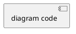

# /reforge.generate

> Generate documentation and artifacts from extracted metadata

## Command Syntax

```
/reforge.generate <format> [--output <path>] [--scope <type>]
```

### Arguments

| Argument | Required | Description |
|----------|----------|-------------|
| `format` | Yes | Output format: `markdown`, `user-stories`, `data-dictionary`, `uml`, `sysml` |
| `--output` | No | Custom output path (defaults to `reforge_output/<project>/generated/`) |
| `--scope` | No | Limit to specific extraction type: `business-rules`, `database`, `ui`, `workflows` |

## Overview

This command generates documentation and artifacts from the XML extractions:

- **markdown**: Comprehensive documentation of all extractions
- **user-stories**: Modernization backlog items with acceptance criteria
- **data-dictionary**: Database entity and column documentation
- **uml**: UML class diagrams in PlantUML/Mermaid notation
- **sysml**: SysML block diagrams for system architecture

## Prerequisites

- At least one extraction must be completed
- Relevant XML files must exist in `reforge_output/<project>/`

---

# Markdown Generation

## Command

```
/reforge.generate markdown
```

## Output

`reforge_output/<project>/generated/documentation.md`

## Template

```markdown
# [Project Name] - Legacy Codebase Documentation

> Generated by Reforge on [timestamp]
> Source: [root-path]

## Table of Contents

1. [Overview](#overview)
2. [Business Rules](#business-rules)
3. [Data Model](#data-model)
4. [User Interface](#user-interface)
5. [Workflows](#workflows)
6. [Traceability Matrix](#traceability-matrix)

---

## Overview

### Analysis Summary

| Metric | Value |
|--------|-------|
| Total Files | [count] |
| Languages | [list] |
| Frameworks | [list] |
| Analysis Date | [date] |

### Extraction Summary

| Type | Items | High Conf | Med Conf | Low Conf |
|------|-------|-----------|----------|----------|
| Business Rules | [N] | [N] | [N] | [N] |
| Database Entities | [N] | [N] | [N] | [N] |
| UI Components | [N] | [N] | [N] | [N] |
| Workflows | [N] | [N] | [N] | [N] |

---

## Business Rules

### By Category

#### Validation Rules

| ID | Description | Confidence | Source |
|----|-------------|------------|--------|
| [id] | [description] | [conf] | [file:line] |

#### Pricing Rules
...

#### Authorization Rules
...

### Rule Details

#### [BR-001]: [Title]

**Category**: [category]
**Confidence**: [level]

**Logic**:
```
[pseudo-code logic]
```

**Source**: `[file]:[line-start]-[line-end]`

```[language]
[code snippet]
```

**Related Entities**: [list]
**Related Rules**: [list]

---

## Data Model

### Entity Relationship Diagram

```mermaid
[ERD diagram]
```

### Entities

#### [Entity Name]

| Column | Type | Nullable | PK | FK |
|--------|------|----------|----|----|
| [name] | [type] | [Y/N] | [✓] | [ref] |

**Source**: `[file]:[lines]`

### Relationships

| From | To | Type |
|------|-----|------|
| [entity.column] | [entity.column] | [type] |

### SQL Interactions

#### By Operation Type

| Operation | Count |
|-----------|-------|
| SELECT | [N] |
| INSERT | [N] |
| UPDATE | [N] |
| DELETE | [N] |

---

## User Interface

### Screen Inventory

| ID | Name | Path | Components |
|----|------|------|------------|
| [id] | [name] | [path] | [count] |

### Screen Details

#### [Screen Name]

**Path**: [url-path]
**Source**: `[file]`

**Layout**:
```
[ASCII layout]
```

**Components**:

| ID | Type | Label | Events |
|----|------|-------|--------|
| [id] | [type] | [label] | [events] |

### Navigation Flows

```mermaid
graph LR
  [flow diagram]
```

---

## Workflows

### Workflow Inventory

| ID | Name | Trigger | Steps | Confidence |
|----|------|---------|-------|------------|
| [id] | [name] | [trigger] | [count] | [level] |

### Workflow Details

#### [WF-001]: [Workflow Name]

**Trigger**: [trigger-type]
**Entry Point**: `[class.method]`
**Confidence**: [level]

**Description**: [description]

**Flow**:
```
1. [step description]
   └─ [method/class]
2. [decision point]
   ├─ [condition A] → [action]
   └─ [condition B] → [action]
3. [step description]
```

**Related Elements**:
- Business Rules: [list]
- Database Operations: [list]
- UI Components: [list]

---

## Traceability Matrix

### Business Rules → Source Files

| Rule | Files |
|------|-------|
| [BR-001] | [file1], [file2] |

### Workflows → Components

| Workflow | Rules | DB Ops | UI |
|----------|-------|--------|-----|
| [WF-001] | [BR-001, BR-002] | [DB-001] | [CMP-001] |

---

## Appendices

### A. File Inventory

[Condensed file listing by language/type]

### B. Glossary

[Entity and term definitions]

### C. Low Confidence Items

[Items requiring clarification]

---

*Generated by Reforge v1.0.0*
```

---

# User Stories Generation

## Command

```
/reforge.generate user-stories
```

## Output Files

- `reforge_output/<project>/generated/user-stories.md` (Markdown)
- `reforge_output/<project>/generated/user-stories.json` (JSON)
- `reforge_output/<project>/generated/user-stories.csv` (CSV)
- `reforge_output/<project>/user-stories.xml` (Schema-compliant XML)

## Generation Process

### Step 1: Load Extractions

Read:
- `business-rules.xml` → Source for acceptance criteria
- `workflows.xml` → Source for user journeys
- `ui-flows.xml` → Source for interaction stories
- `database.xml` → Source for data-related stories

### Step 2: Generate Epics

Group related functionality into epics:

1. **From workflows**: Each major workflow becomes an epic
2. **From UI screens**: Related screens become epics
3. **From domain entities**: CRUD operations per entity

### Step 3: Generate Stories

For each epic, create stories:

#### From Business Rules

```
Rule: "Apply 10% discount for orders over $100"

→ Story: "Apply Order Discount"
  As a: Customer
  I want: to receive applicable discounts on my order
  So that: I pay a fair price based on my order value

  Acceptance Criteria:
  - Given I have items totaling over $100
    When I submit my order
    Then a 10% discount is applied

  Traceability: BR-001
```

#### From Workflows

```
Workflow: "Order Submission"

→ Epic: "Order Management"
  Stories:
  - Create new order
  - Submit order for processing
  - View order status
  - Cancel pending order

  Each with steps from workflow as acceptance criteria
```

#### From UI Components

```
Screen: "Order List"
Button: "New Order"

→ Story: "Create New Order"
  As a: User
  I want: to create a new order from the order list
  So that: I can start the ordering process

  Traceability: SCR-001, CMP-001
```

### Step 4: Assign Priority

| Source Signal | Priority |
|---------------|----------|
| High-confidence business rule | High |
| Core workflow entry point | High |
| Primary UI screen | High |
| Medium-confidence rule | Medium |
| Secondary workflow | Medium |
| Supporting UI component | Low |

### Step 5: Estimate Story Points

| Complexity | Points |
|------------|--------|
| Single rule, no branches | 1-2 |
| Rule with conditions + workflow | 3-5 |
| Multiple workflows + UI + database | 5-8 |
| Complex branching + external calls | 8-13 |

### Step 6: Generate Outputs

#### Markdown Output

Use template from `.reforge/templates/user-story.md`:

```markdown
# Modernization User Stories

> Generated from [project] analysis on [date]

## Epic: [Epic Title]

### US-001: [Story Title]

**Priority**: High | **Points**: 5

**As a** [role],
**I want** [action],
**So that** [benefit].

#### Acceptance Criteria

- [ ] **AC-001**: Given [context], when [action], then [outcome].
- [ ] **AC-002**: Given [context], when [action], then [outcome].

#### Traceability

| Type | ID | Confidence |
|------|-----|------------|
| Business Rule | BR-001 | High |
| Workflow | WF-001 | High |
| UI Component | CMP-001 | High |

---
```

#### JSON Output

```json
{
  "project": "[project-name]",
  "generated": "[timestamp]",
  "epics": [
    {
      "id": "EPIC-001",
      "title": "[title]",
      "stories": ["US-001", "US-002"]
    }
  ],
  "stories": [
    {
      "id": "US-001",
      "title": "[title]",
      "epic_ref": "EPIC-001",
      "priority": "high",
      "points": 5,
      "as_a": "[role]",
      "i_want": "[action]",
      "so_that": "[benefit]",
      "acceptance_criteria": [
        {
          "id": "AC-001",
          "given": "[context]",
          "when": "[action]",
          "then": "[outcome]",
          "source_ref": "BR-001"
        }
      ],
      "traceability": {
        "business_rules": ["BR-001"],
        "workflows": ["WF-001"],
        "ui_components": ["CMP-001"],
        "database_ops": []
      }
    }
  ]
}
```

#### CSV Output

```csv
ID,Title,Epic,Priority,Points,As A,I Want,So That,Criteria Count,Rules,Workflows
US-001,"[title]",EPIC-001,high,5,"[role]","[action]","[benefit]",2,"BR-001","WF-001"
```

### Step 7: Report Results

```
User Stories Generation Complete!

Output files:
- reforge_output/[project]/generated/user-stories.md
- reforge_output/[project]/generated/user-stories.json
- reforge_output/[project]/generated/user-stories.csv
- reforge_output/[project]/user-stories.xml

Summary:
- Epics: 8
- Stories: 45
- Total story points: 187

Priority breakdown:
- Critical: 5 stories (28 points)
- High: 15 stories (67 points)
- Medium: 18 stories (72 points)
- Low: 7 stories (20 points)

Stories ready for import into project management tools.
```

---

# Data Dictionary Generation

## Command

```
/reforge.generate data-dictionary
```

## Output

`reforge_output/<project>/generated/data-dictionary.md`

## Template

Use `.reforge/templates/data-dictionary.md`:

```markdown
# Data Dictionary: [Project Name]

> Generated: [timestamp]

## Overview

| Metric | Value |
|--------|-------|
| Total Entities | [N] |
| Total Relationships | [N] |
| Discovery Sources | [DDL, ORM, Inferred] |

---

## Entities

### [Entity Name]

| Property | Value |
|----------|-------|
| ID | `[E-XXX]` |
| Type | [table/view/entity/dto] |
| Source | [ddl/orm/inferred] |
| Confidence | [high/medium/low] |
| Location | `[file:lines]` |

#### Columns

| Column | Type | Nullable | PK | FK | Description |
|--------|------|----------|----|----|-------------|
| `[name]` | [type] | [Y/N] | [✓] | `[ref]` | [desc] |

#### Referenced By

| Entity | Column | Relationship |
|--------|--------|--------------|
| [entity] | [column] | [type] |

---

## Relationships

| From | → | To | Type |
|------|---|-----|------|
| `[entity.column]` | → | `[entity.column]` | [type] |

---

## Entity Relationship Diagram

### PlantUML



### Mermaid

```mermaid
erDiagram
[diagram code]
```
```

---

# UML Diagram Generation

## Command

```
/reforge.generate uml
```

## Output

`reforge_output/<project>/generated/diagrams/class-diagram.puml`
`reforge_output/<project>/generated/diagrams/class-diagram.mmd`

## Template

Use `.reforge/templates/uml-class.md`:

### PlantUML Output

```plantuml
@startuml [project]-class-diagram
!theme plain
skinparam linetype ortho

title [Project Name] - Class Diagram

' Entities from database extraction
class [EntityName] {
  +[pk_column] : [type]
  -[column] : [type]
  -[fk_column] : [type]
}

' Relationships
[Entity1] "1" -- "*" [Entity2] : [relationship]

@enduml
```

### Mermaid Output

```mermaid
classDiagram
    direction TB

    class [EntityName] {
        +[type] [pk_column]
        -[type] [column]
    }

    [Entity1] "1" -- "*" [Entity2] : [relationship]
```

---

# SysML Diagram Generation

## Command

```
/reforge.generate sysml
```

## Output

`reforge_output/<project>/generated/diagrams/block-diagram.puml`

## Template

Use `.reforge/templates/sysml-block.md`:

```plantuml
@startuml [project]-bdd
!theme plain

title [Project Name] - Block Definition Diagram

' Blocks from workflow analysis
package "[System Name]" <<block>> {

  block "[Module Name]" as M1 <<block>> {
    ' Parts from entities
    part [entity] : [EntityType]
    --
    ' Operations from workflows
    op [methodName]([params]) : [return]
  }

}

' Relationships
M1 --> M2 : [relationship]

@enduml
```

---

## Selective Regeneration

When extractions are updated:

1. **Detect changes**: Compare extraction timestamps with generation timestamps
2. **Identify affected sections**: Map changed extractions to document sections
3. **Regenerate selectively**: Update only affected parts
4. **Preserve custom edits**: Maintain user-added notes in designated sections

---

## Output Schema Reference

- User Stories: `.reforge/schemas/user-stories.md`
- Templates: `.reforge/templates/`
