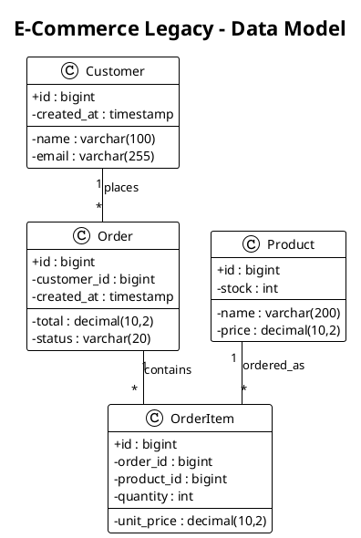
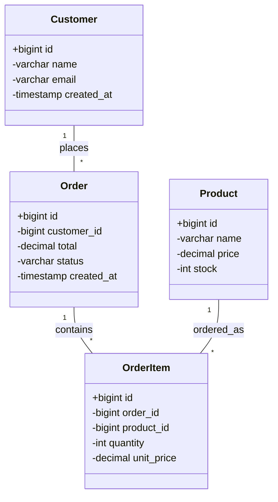

# UML Class Diagram Template

> Template for generating UML class diagrams from extracted data models

## Overview

This template generates class diagrams in both PlantUML and Mermaid formats for visualizing:
- Data entities and their relationships
- Business rule dependencies
- Workflow participants

## Template Variables

| Variable | Source | Description |
|----------|--------|-------------|
| `{{project.name}}` | Analysis | Project name |
| `{{entities}}` | Database extraction | Data entities |
| `{{relationships}}` | Database extraction | Entity relationships |
| `{{rules}}` | Business rules extraction | Business rules (optional) |

## PlantUML Output Template

```plantuml
@startuml {{project.name}}-class-diagram
!theme plain
skinparam linetype ortho
skinparam classAttributeIconSize 0

title {{project.name}} - Data Model

{{#each entities}}
class {{this.name}} {
{{#each this.columns}}
  {{#if this.primary_key}}+{{else}}-{{/if}}{{this.name}} : {{this.data_type}}
{{/each}}
}

{{/each}}

' Relationships
{{#each relationships}}
{{#if (eq this.type "one-to-one")}}
{{this.from_entity}} "1" -- "1" {{this.to_entity}} : {{this.from_column}}
{{else if (eq this.type "one-to-many")}}
{{this.to_entity}} "1" -- "*" {{this.from_entity}} : {{this.from_column}}
{{else if (eq this.type "many-to-many")}}
{{this.from_entity}} "*" -- "*" {{this.to_entity}}
{{/if}}
{{/each}}

@enduml
```

## Mermaid Output Template

```mermaid
classDiagram
    direction TB

{{#each entities}}
    class {{this.name}} {
{{#each this.columns}}
        {{#if this.primary_key}}+{{else}}-{{/if}}{{this.data_type}} {{this.name}}
{{/each}}
    }

{{/each}}

{{#each relationships}}
{{#if (eq this.type "one-to-one")}}
    {{this.from_entity}} "1" -- "1" {{this.to_entity}} : {{this.from_column}}
{{else if (eq this.type "one-to-many")}}
    {{this.to_entity}} "1" -- "*" {{this.from_entity}} : {{this.from_column}}
{{else if (eq this.type "many-to-many")}}
    {{this.from_entity}} "*" -- "*" {{this.to_entity}}
{{/if}}
{{/each}}
```

## Relationship Notation

### PlantUML Relationships

| Relationship | Notation | Meaning |
|--------------|----------|---------|
| Association | `--` | Basic association |
| Composition | `*--` | Strong ownership (lifecycle) |
| Aggregation | `o--` | Weak ownership |
| Inheritance | `<\|--` | Extends/implements |
| Dependency | `..>` | Uses/depends on |

### Cardinality Notation

| Symbol | Meaning |
|--------|---------|
| `"1"` | Exactly one |
| `"0..1"` | Zero or one |
| `"*"` | Many (zero or more) |
| `"1..*"` | One or more |
| `"n..m"` | Range |

## Example Output

### PlantUML



### Mermaid



## Styling Guidelines

### PlantUML Themes

Available themes for different contexts:

| Theme | Use Case |
|-------|----------|
| `plain` | Clean, minimal diagrams |
| `blueprint` | Technical documentation |
| `cerulean` | Modern, colorful |
| `sketchy` | Draft/conceptual diagrams |

### Color Coding (Optional)

```plantuml
' Entity types
skinparam class {
  BackgroundColor<<table>> LightBlue
  BackgroundColor<<view>> LightGreen
  BackgroundColor<<dto>> LightYellow
}
```

## Generation Notes

### Source-Anchored Generation (Mandatory)

All generated UML class diagrams MUST comply with the Source-Anchored Generation constraints
defined in Step 0.6 of `.reforge/commands/generate.md`. Key obligations:

1. Extraction XML is the sole source of truth for all diagram content
2. All identifiers (class names, column names, relationship labels) MUST be copied verbatim from extraction XML
3. All statistics (entity counts, relationship counts) MUST be computed with visible derivation formulas
4. `[DATA GAP]` markers MUST replace any content not supported by extraction data
5. Provenance annotations MUST cite extraction source files and element counts
6. The Content Validation Checklist MUST be completed before finalizing any diagram output
7. The agent MUST NOT read source code files directly — all source context comes from extraction XML

## Generation Notes

When generating class diagrams:

1. **Simplify types** - Use short type names (varchar vs varchar(255))
2. **Show key columns** - Always highlight primary/foreign keys
3. **Group related classes** - Use packages/namespaces for large models
4. **Label relationships** - Use meaningful names (not just FK column)
5. **Handle large models** - Split into domain-specific diagrams if >15 entities
