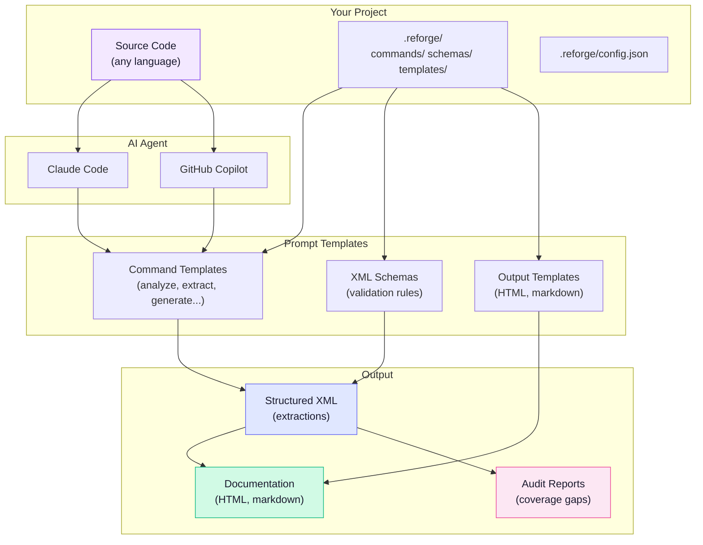

---
tags:
  - architecture
---

# How It Works

Reforge is a set of **prompt templates** that guide an AI coding agent through structured analysis workflows. There are no parsers, no compilers, no runtime dependencies -- just markdown templates and configuration files that tell the agent what to do.

## Architecture Overview



## Core Concept

When you run a command like `/reforge.analyze`, the AI agent loads a markdown template from `.reforge/commands/analyze.md`. That template contains step-by-step instructions the agent follows using its native file tools (Read, Glob, Grep, Write). The agent reads your source code, reasons about it, and produces structured XML output.

This means Reforge works with **any programming language** without language-specific tooling. The AI understands code semantically -- it doesn't need an AST parser for Java or a Tree-sitter grammar for COBOL. It reads the code and extracts meaning directly.

## Architecture Principles

| Principle | What it means |
|-----------|---------------|
| **No parsers** | The AI reads source files directly -- no AST, no Tree-sitter, no language plugins |
| **No runtime** | Framework is pure markdown templates + JSON configuration |
| **Structured output** | Results stored as XML with defined schemas for consistency |
| **Source traceability** | Every extracted element links back to file path, line number, and code snippet |
| **Checkpoint/resume** | Long analyses can be interrupted and continued later |
| **Agent-agnostic** | Works with Claude Code, GitHub Copilot, or any AI coding assistant |

## How Commands Work

Each Reforge command is a **slash command** backed by a markdown prompt template:

```
/reforge.analyze  -->  .reforge/commands/analyze.md
/reforge.extract  -->  .reforge/commands/extract.md
/reforge.generate -->  .reforge/commands/generate.md
```

The template defines:

- **Inputs** -- what the command needs (e.g., extraction type, file patterns)
- **Steps** -- the structured workflow the agent follows
- **Outputs** -- what files get created and where
- **Validation** -- checks the agent runs to verify its work

When installed for Claude Code, thin wrapper files in `.claude/commands/` register these as `/reforge.*` slash commands. For GitHub Copilot, agent files in `.github/agents/` register them as `@reforge.*` commands.

## Structured XML Output

All extraction results are stored as XML files with defined schemas. Here is a simplified example:

```xml
<business-rules
    xmlns="http://reforge.dev/schema/extraction"
    project-id="my-app"
    schema-version="1.0.0"
    generated="2026-03-04T12:00:00Z">
  <metadata>
    <total-count>42</total-count>
    <confidence-distribution>
      <high>30</high>
      <medium>10</medium>
      <low>2</low>
    </confidence-distribution>
  </metadata>
  <rule id="BR-VAL-001" confidence="high">
    <name>Email format validation</name>
    <source file="src/validators/email.py" line-start="45" line-end="52">
      <snippet>def validate_email(value): ...</snippet>
    </source>
  </rule>
</business-rules>
```

Key properties of the output format:

- **Schemas** define the structure for each extraction type (see [Schemas](schemas.md))
- **Source references** link every element to a file and line range
- **Confidence levels** (high, medium, low) indicate extraction certainty
- **Metadata** provides summary counts and timestamps

## Source Traceability

Every extracted element includes a `<source>` reference pointing back to the original code:

```xml
<source file="src/auth/login.py" line-start="112" line-end="128">
  <snippet>def authenticate_user(username, password): ...</snippet>
</source>
```

This means you can always trace a business rule, database query, or workflow step back to the exact code that implements it. The `file` attribute uses relative paths from the project root, and `line-start`/`line-end` identify the precise line range.

## Checkpoint and Resume

Long-running analyses (especially on large codebases) support checkpointing. If you interrupt an analysis, the agent saves its progress to `.reforge/memory/checkpoints/`. When you resume with `--resume`, it picks up where it left off instead of starting over.

Checkpointing works for:

- `/reforge.analyze` -- codebase scanning
- `/reforge.extract` -- knowledge extraction
- `/reforge.glossary` -- multi-phase glossary pipeline
- `/reforge.fix` -- correction execution

## Agent-Agnostic Design

Reforge works with any AI coding assistant that can read files, write files, and follow structured instructions. The prompt templates are written in agent-neutral language -- they say "the agent MUST" rather than referencing a specific tool.

Currently supported agents:

| Agent | Install flag | Command prefix |
|-------|-------------|----------------|
| Claude Code | `--claude` | `/reforge.*` |
| GitHub Copilot | `--copilot` | `@reforge.*` |

Both agents use the same shared framework files. The only difference is how commands are registered (slash commands vs. agent files).

## Directory Structure

### Framework files (installed in your project)

```
.reforge/
├── commands/       # Prompt templates -- one per command
├── schemas/        # XML output structure definitions
├── templates/      # Generation templates (UML, user stories, etc.)
├── memory/         # Project state, checkpoints, constitution
│   ├── constitution.md      # Governing principles
│   ├── project-context.md   # Project-specific context (from /reforge.init)
│   ├── extraction-profile.md # Language-specific guidance (from /reforge.profile)
│   └── checkpoints/         # Resume state (gitignored)
└── config.json     # Project configuration
```

### Output files (generated during analysis)

```
reforge_output/<project-name>/
├── analysis/       # Codebase inventory (analysis.xml)
├── extractions/    # Extracted knowledge (business-rules.xml, database.xml, etc.)
├── derived/        # Cross-referenced artifacts (cross-mappings, registries)
├── generated/      # Documentation output (markdown, user-stories, HTML)
├── audit/          # Audit reports and correction plans
└── diagrams/       # UML/SysML diagram sources and renders
```

## Workflow Overview

The typical analysis workflow progresses through four phases:

```
Planning (optional)
  └── /reforge.plan

Setup
  ├── /reforge.init       # Define project context
  ├── /reforge.analyze    # Inventory the codebase
  └── /reforge.profile    # Generate extraction profile

Extraction (per type)
  ├── /reforge.extract    # Extract knowledge
  ├── /reforge.clarify    # Resolve ambiguities
  ├── /reforge.audit      # Check coverage
  └── /reforge.fix        # Fill gaps

Generation
  └── /reforge.generate   # Produce documentation
```

Each extraction type (business-rules, database, ui, workflows, and the extended types) follows the same extract-clarify-audit-fix pipeline independently. See the [Commands Reference](../commands/index.md) for details on each command.
