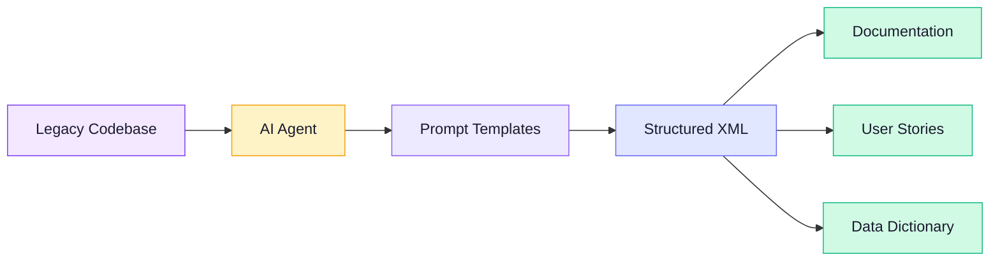

---
hide:
  - navigation
  - toc
tags:
  - overview
---

<div class="hero" markdown>

# Reforge

<p class="hero-tagline">
  Turn legacy codebases into structured knowledge — powered by AI agents, guided by prompt templates, with zero external dependencies.
</p>

<div class="hero-buttons" markdown>

[Get Started :material-rocket-launch:](getting-started/installation.md){ .md-button .md-button--primary }
[Commands Reference :material-book-open-variant:](commands/index.md){ .md-button }
[View on GitHub :fontawesome-brands-github:](https://github.com/Aditi-Consulting/reforge){ .md-button }

</div>
</div>

---

## What Reforge Does

Point your AI coding agent at a legacy codebase. Reforge's prompt templates guide it through **systematic analysis, knowledge extraction, and documentation generation** — producing structured XML with full source traceability.



---

## Feature Highlights

<div class="grid cards" markdown>

-   :material-code-not-equal-variant:{ .lg .middle } **Zero Dependencies**

    ---

    No parsers, no AST tools, no language plugins. The AI reads source files directly using its native file tools.

-   :material-robot-outline:{ .lg .middle } **Agent-Agnostic**

    ---

    Works with Claude Code (`/reforge.*`) and GitHub Copilot (`@reforge.*`). Install both on the same project.

-   :material-file-tree:{ .lg .middle } **{{ extraction_types }} Extraction Types**

    ---

    Business rules, database, UI flows, workflows, call-sites, dependencies, functional requirements, non-functional requirements, architecture, and issues.

-   :material-xml:{ .lg .middle } **Structured XML Output**

    ---

    Every extraction produces schema-validated XML with confidence levels and source file traceability (file, line, snippet).

-   :material-content-save-check:{ .lg .middle } **Checkpoint & Resume**

    ---

    Interrupt long-running analyses and pick up where you left off. Works across sessions.

-   :material-shield-check:{ .lg .middle } **Audit & Fix Cycle**

    ---

    Automated coverage auditing identifies gaps. The fix command fills them by dispatching to the appropriate extraction commands.

</div>

---

## Before & After

<div class="before-after" markdown>
<div class="panel" markdown>

#### Before: Legacy source code

```python
def calc_disc(cust, ord):
    # FIXME: magic numbers
    if cust.type == 3 and ord.total > 500:
        return ord.total * 0.15
    elif cust.years > 5:
        return ord.total * 0.10
    return 0
```

</div>
<div class="panel" markdown>

#### After: Extracted business rule

```xml
<rule id="BR-DISC-001" confidence="high">
  <name>Tiered customer discount</name>
  <description>
    Premium customers (type 3) with orders
    over $500 receive 15% discount.
    Customers with 5+ year tenure get 10%.
  </description>
  <source file="src/pricing.py"
          line-start="12" line-end="18"/>
</rule>
```

</div>
</div>

---

## How It Compares

| Capability | Manual Analysis | Reforge |
|:-----------|:--------------:|:-------:|
| Language-specific tooling required | Yes | No |
| Source traceability | Manual effort | Automatic |
| Structured output format | Varies | Schema-validated XML |
| Checkpoint & resume | No | Yes |
| Audit coverage gaps | Manual review | Automated |
| Time for 50K LOC project | Weeks | Hours |

---

## Quick Links

- [**Installation**](getting-started/installation.md) — Install Reforge and analyze your first codebase in 5 minutes
- [**Commands**](commands/index.md) — Full reference for all `/reforge.*` commands
- [**Workflow Guide**](guides/workflow.md) — Step-by-step analysis walkthrough
- [**Architecture**](architecture/overview.md) — How the framework works under the hood
